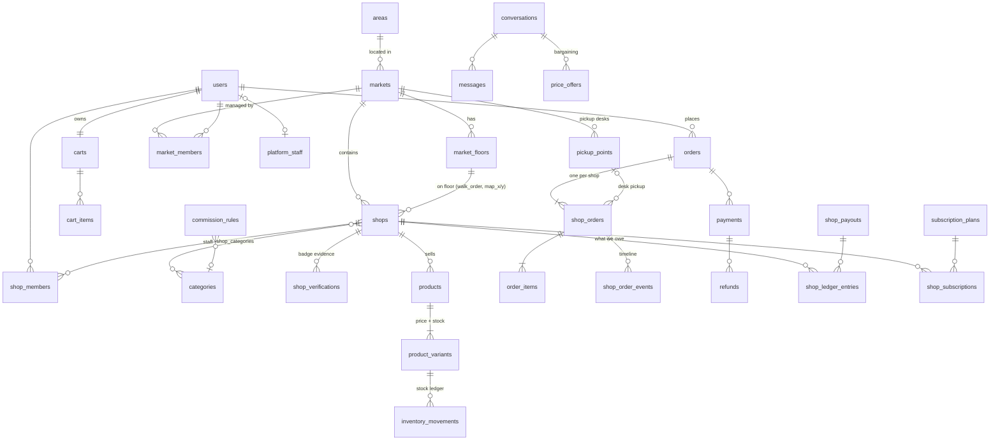

# Database design

PostgreSQL 17 · TypeORM 1.1 · 66 tables. The entities in `backend/src/database/entities/` are the source of truth. Schema changes are made only through migrations in `backend/src/database/migrations/`. [`schema.sql`](schema.sql) is a `pg_dump --schema-only` of the result, kept for reading and review.

## Principles

| Rule | Why |
|---|---|
| **Membership tables for roles:** one `users` table plus `platform_staff`, `market_members`, `shop_members` (and `riders` later) | One person can be a customer, a shop owner and a mall manager at the same time |
| **Phone + OTP login**, no password column | Matches how Bangladeshi users sign in. OTP codes live in Redis with a TTL and are stored hashed |
| **Money is `numeric(12,2)`**, read as JS numbers through a transformer | Floats are never used for money |
| **`*_en` + `*_bn` columns** | The UI is Bangla-first; English keeps search and SEO working |
| **Status columns are `varchar` + named `CHECK` constraints** (`CHK_<table>_<col>`), generated from `common/enums.ts` | Easier to extend than Postgres `ENUM`, and invalid states are still impossible |
| **Snapshots on order lines:** product name, price, commission rate | Old orders never change when a shop edits a product or admin changes commission |
| **Append-only ledgers:** `inventory_movements`, `shop_ledger_entries`, `shop_order_events`, `audit_logs` | Every counter can be explained and audited |
| **Integer identity PKs**; `bigint` for high-volume logs (messages, notifications, movements, search queries, audit) | Small, fast keys, with room where volume is high |
| **Soft delete** (`deleted_at`) on markets, shops, products | Orders keep referring to them |
| **[PHASE 2] tables exist now:** riders, deliveries, addresses | Delivery can launch without a migration crunch |

## Modules

| Module | Tables |
|---|---|
| Geography | `divisions` → `districts` → `areas` → `sub_areas` |
| People & roles | `users`, `platform_staff`, `user_devices`, `user_addresses` |
| Malls & markets | `markets`, `market_floors`, `market_members`, `pickup_points` |
| Taxonomy | `categories` (tree, with a Lucide icon name), `brands`, `size_charts` |
| Shops | `shops`, `shop_members`, `shop_categories`, `shop_hours`, `shop_verifications`, `shop_payout_accounts` |
| Catalogue & stock | `products`, `product_variants`, `product_images`, `inventory_movements` |
| Engagement | `wishlist_items`, `shop_follows`, `conversations`, `messages`, `price_offers` |
| Cart | `carts`, `cart_items` |
| Promotions | `coupons`, `coupon_redemptions`, `gift_cards`, `gift_card_transactions` |
| Orders | `orders`, `shop_orders`, `order_items`, `shop_order_events` |
| Payments | `payments`, `payment_webhook_events`, `refunds` |
| After-sale | `return_requests`, `return_items`, `reviews`, `support_tickets`, `support_ticket_notes` |
| Revenue | `commission_rules`, `subscription_plans`, `shop_subscriptions`, `shop_ledger_entries`, `shop_payouts`, `ad_campaigns` |
| Delivery by courier (3PL) | `courier_accounts`, `shipments`, `shipment_events` |
| Own riders (later) | `riders`, `deliveries`, `delivery_shop_orders` |
| Platform | `notifications`, `platform_settings`, `search_queries`, `audit_logs`, `import_jobs` |

## Core relationships



## How the key flows use the schema

### Mall walk-through
`market_floors.level` orders the floors, and `shops.walk_order` orders shops within a floor. `shops.map_x/map_y` are percentage positions for pins on the floor plan (`market_floors.map_image_url`). The index `IDX_shops_walk (market_id, floor_id, walk_order)` serves the directory query, and the view `v_market_directory` exposes the same thing to SQL users.

### Search (Bangla + English)
- `products.search_vector` is a **generated** `tsvector('simple', name_en ‖ name_bn ‖ description)` column with a GIN index.
- Trigram GIN indexes (`pg_trgm`) sit on `name_en ‖ name_bn` for markets, shops and products. Queries combine `ILIKE`, full-text search and `word_similarity()`, so "panjbi" still finds "Panjabi".
- `search_queries` logs every search and its result count. The admin's "zero-result searches" list comes from here.

### Stock that cannot oversell
- `product_variants` has `stock_qty`, `reserved_qty` and `available_qty`, a **generated** column equal to `stock_qty - reserved_qty`.
- `CHECK (reserved_qty <= stock_qty)` and `CHECK (stock_qty >= 0)` are enforced in the database.
- Checkout locks the variants with `SELECT … FOR UPDATE`, then reserves with `UPDATE … WHERE stock_qty - reserved_qty >= :qty`.
- Every change writes an `inventory_movements` row: `reserve`, `release`, `online_sale`, `offline_sale`, `restock`, `return`, `import`, and so on.

### One cart, many shops
- `orders` is what the customer pays: a `CHECK` enforces `grand_total = subtotal − discount + pickup_fee + delivery_fee`.
- `shop_orders` is what each shop fulfils. Each row has its own status, `pickup_code`, `reserved_until`, `cash_due` and `commission_total`.
- Status changes are written to `shop_order_events`, and the parent `orders.status` is rolled up from its shop orders.

Shop order states:

```
pickup:    placed ─▶ confirmed ─▶ ready_for_pickup ─▶ completed
                                                └──▶ expired (reserved_until passed; job runs every minute)
delivery:  placed ─▶ confirmed ─▶ shipped (booked with the courier) ─▶ completed (delivered)
                                                                └──▶ returned (courier sent it back)
either:    placed / confirmed ─▶ rejected / cancelled
```

### Home delivery and the courier (Steadfast)
- `shop_orders.fulfillment_type = 'delivery'` parts carry `delivery_fee` (by zone, from `platform_settings`), and the parent `orders.delivery_address` keeps a JSON snapshot of the address. Saved addresses live in `user_addresses` (`district`, `area_name`, `zone`).
- `shops.offers_delivery` turns home delivery on or off per shop.
- `courier_accounts` holds each shop's courier login (`provider`, `mode` = `live` or `mock`, keys never returned by the API, `is_default`). Adding Pathao or RedX means a new `provider` value and client class; the tables stay the same.
- `shipments` has one row per delivery shop order (`UNIQUE shop_order_id`): `consignment_id`, `tracking_code`, our `status` (`booked → in_transit / on_hold → delivered / partial_delivered / returned / cancelled`), the courier's raw status word, `cod_amount` (= `shop_orders.cash_due`) and the recipient snapshot.
- `shipment_events` logs every status change with its `source` (`booking`, `webhook`, `poll`, `manual`) and the raw payload.
- Stock: it is sold when the parcel is booked (`shipped`) and put back if it is returned. A delivered COD parcel records a `cash` payment with `gateway = 'steadfast'`. The ledger only moves the online part and the commission, because the courier settles the cash with the shop.

### Places and nearby
- Four levels, each pointing at its parent: `divisions` ← `districts.division_id` ← `areas.district_id` ← `sub_areas.area_id`. Names are unique per parent, every row has `is_active` (hidden rows leave the public pickers but keep their history), and foreign keys block deleting a place that still has children or markets.
- `markets.area_id` (required) and `markets.sub_area_id` (optional) place a market; division and district come from the area. Shops inherit their market's place (a standalone shop uses its own `area_id`).
- Filtering markets and shops by division, district, area or sub-area is a join up that chain.
- **Nearby**: markets carry `latitude`/`longitude`. The customer's position comes with the request; a bounding box in SQL narrows the candidates, then the great-circle (haversine) distance is computed and compared with the platform setting `nearby_max_km` (admin-editable, default 0.5 km; a customer may narrow it per search with `radiusKm`). A shop is as far away as its market. Results are sorted nearest first.

### Bargaining
- `price_offers` moves `pending → countered → accepted → used`, or ends as `rejected`, `withdrawn` or `expired`.
- `product_variants.min_offer_price` is a hidden floor: offers below it are rejected automatically. The API never exposes it to customers.
- An accepted offer is linked from `cart_items.offer_id` and `order_items.offer_id`, and `unit_price` stores the bargained price.

### Payments: trust first
An order can have several `payments`:

| Scenario | Rows |
|---|---|
| bKash/Nagad in full | 1 × `full` |
| Cash, but the shop asks for a deposit (`shops.deposit_percent`), or the customer has `users.no_show_count` ≥ threshold | 1 × `deposit` online, then 1 × `cash` / `balance` at pickup (`collected_by` = staff) |
| Cash only | 1 × `cash` / `full` at pickup |
| Cash on delivery | 1 × `cash` / `full` (`gateway = 'steadfast'`) when the courier reports it delivered, after any advance paid online |

Gateway callbacks go to `payment_webhook_events`, which is unique on `(gateway, event_id)`. Together with `UNIQUE (gateway, gateway_trx_id)` on `payments`, this makes callback handling idempotent.

### Money owed to shops
`shop_ledger_entries` holds signed entries, and the balance is their `SUM` (view `v_shop_balance`):

| Event | Entry |
|---|---|
| Shop order completed | `+sale` (only the part paid online), `−commission`, and `+adjustment` when the platform funded a coupon |
| Deposit forfeited after a no-show | `+sale` (the shop keeps the deposit) |
| Refund for a return | `−refund` |
| Payout sent | `−payout` (linked to `shop_payouts`) |

Cash the shop collects itself never enters the ledger; only the commission on it does.

### Commission
`commission_rules` rows are never edited: a rule is ended (`valid_to`) and a new one created. When an order is placed, the most specific active rule wins:

> shop (8) > market (4) > exact category (2) > parent category (1) > global (0)

The shop's plan `commission_discount` is then subtracted, and the resulting rate and amount are stored on `order_items`. The zero-commission launch is simply a global 0% rule with an end date.

### Verified badge
`shops.is_verified` is recomputed whenever a `shop_verifications` row changes. It is true only when an **approved `trade_license`** and an **approved `physical_visit`** both exist.

## Indexes worth knowing

- `UQ_shops_market_number`: shop numbers are unique within a market (partial index: not null and not deleted).
- `UQ_user_addresses_one_default`, `UQ_shop_payout_accounts_one_default`, `UQ_shop_subscriptions_one_current`: partial unique indexes that enforce "only one".
- `UQ_reviews_one_per_target (shop_order_id, coalesce(product_id, 0))`: one review per order for the shop and one per product.
- `IDX_shop_orders_reserved_until`: a partial index over open orders only, used by the expiry job.
- `UQ_users_email_lower`: emails are unique regardless of case.

## Working with migrations

```bash
npm run migration:run               # apply pending migrations
npm run migration:generate -- Name  # diff entities against the DB and write a new migration
npm run migration:revert            # roll back the last migration
```

Indexes that TypeORM decorators cannot express are hand-written in `…-SearchIndexesAndViews.ts`: trigram and expression indexes, plus the views. They are declared on the entities with `synchronize: false` so the generator never tries to drop them.
